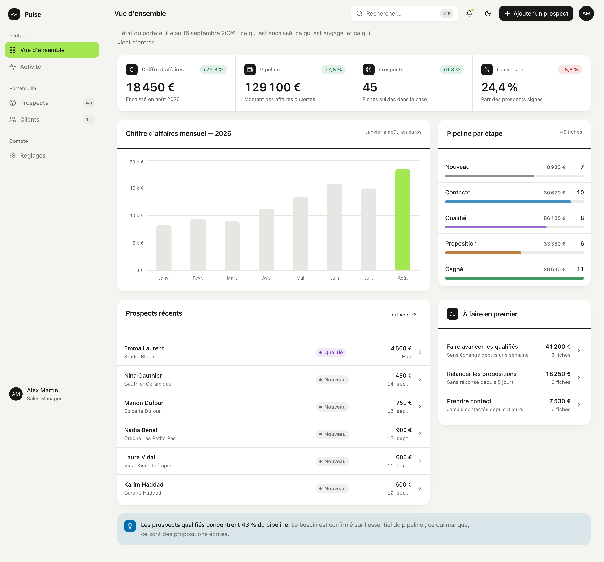
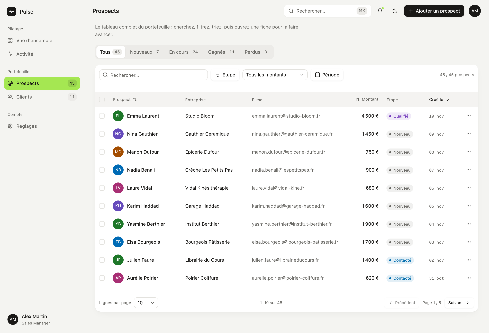
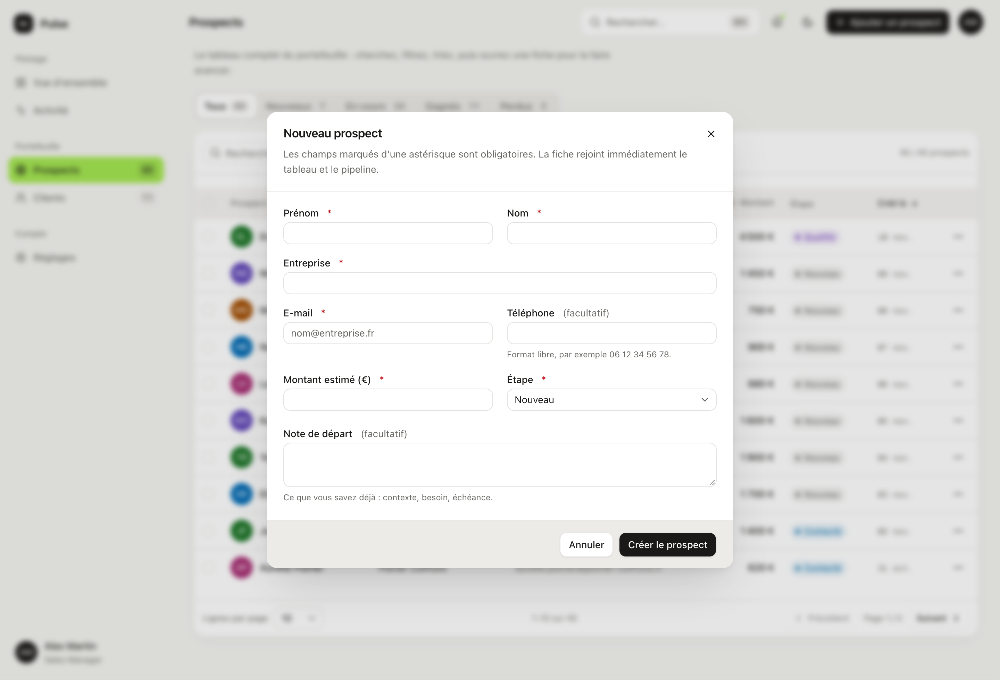
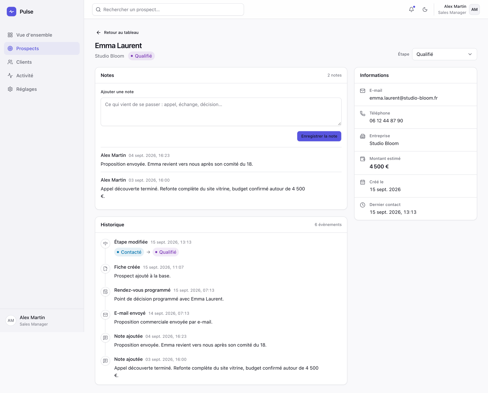
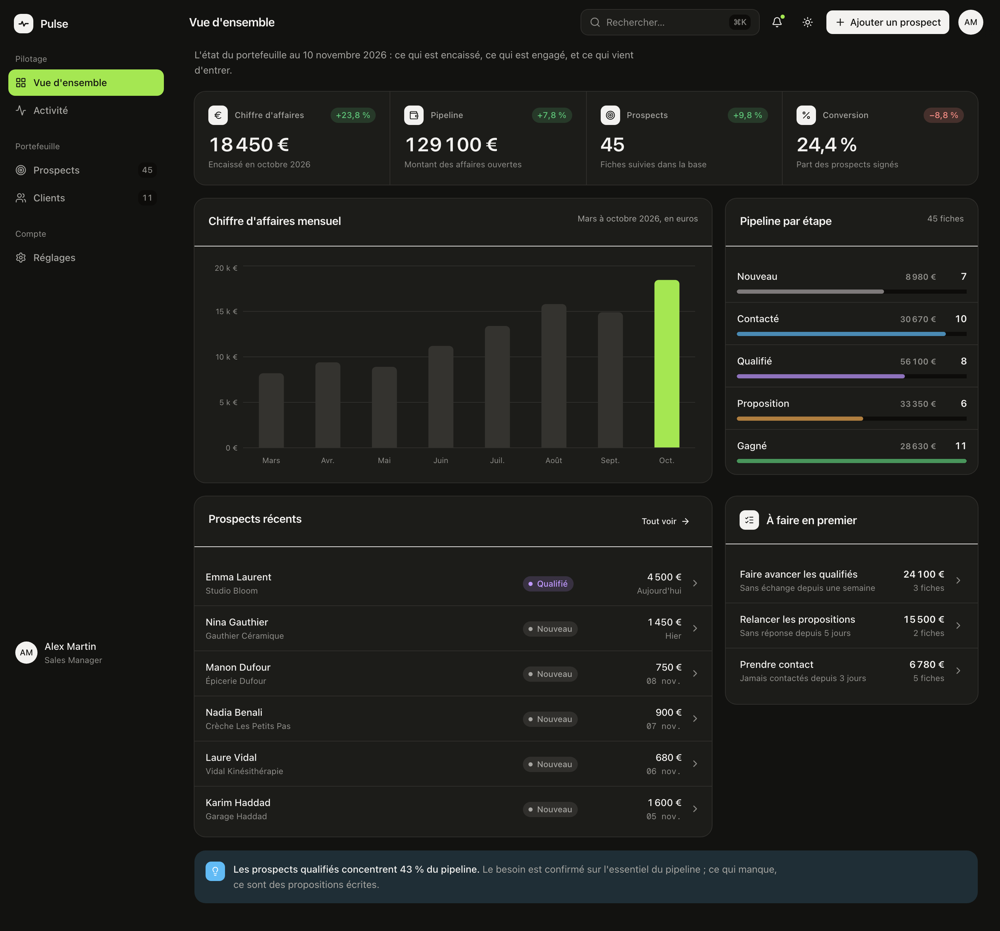
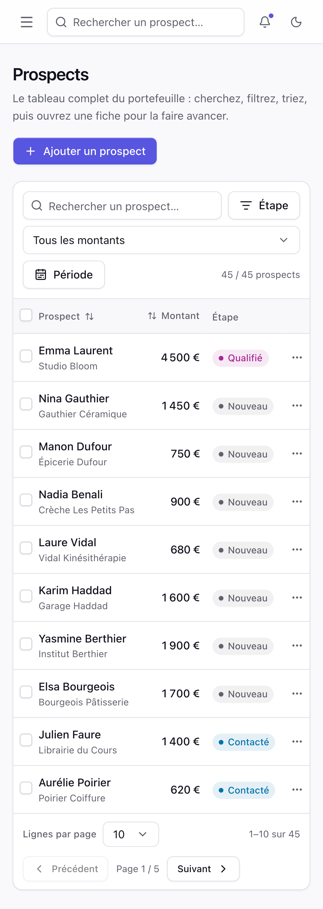

# Pulse — CRM & Analytics

[](https://github.com/alexreu/pulse/actions/workflows/ci.yml)

**[Voir la démo en ligne →](https://pulse-gilt-chi-55.vercel.app)** — sans inscription. Vos
modifications restent propres à votre navigateur ; un bouton dans les réglages remet le jeu
de départ.

> Pulse est une application fictive réalisée à des fins de démonstration.
> Aucune donnée n'est réelle : prospects, entreprises, montants, notes et
> activités ont été écrits à la main pour ce projet.

Pulse est un CRM simplifié qui permet à une petite équipe commerciale de suivre
ses prospects, ses clients, son chiffre d'affaires potentiel, son pipeline et
son activité. C'est une application métier complète — tableau de données,
formulaires validés, états, graphiques, thème clair et sombre — pas une page
vitrine qui décrit un produit.

[](https://pulse-gilt-chi-55.vercel.app)

---

## Sommaire

- [Contexte](#contexte)
- [Stack](#stack)
- [Fonctionnalités](#fonctionnalités)
- [Captures](#captures)
- [Architecture](#architecture)
- [Installation](#installation)
- [Tests](#tests)
- [Décisions techniques](#décisions-techniques)
- [Design system](#design-system)
- [Accessibilité](#accessibilité)
- [Limites assumées](#limites-assumées)
- [Déploiement](#déploiement)

---

## Contexte

**L'utilisateur.** Un commercial ou un responsable commercial dans une équipe de
deux à dix personnes. Il ouvre Pulse plusieurs fois par jour depuis son poste,
et le consulte depuis son téléphone entre deux rendez-vous. Son travail :
connaître l'état du pipeline, retrouver un prospect en quelques secondes,
consigner ce qui vient de se passer, faire avancer une affaire d'une étape.

**Le périmètre.** Pulse est un artefact de portfolio. Il doit prouver, en étant
utilisé plutôt qu'en étant décrit, qu'une interface métier crédible peut sortir
de ces mains : architecture, composants réutilisables, formulaires complexes,
tableau interactif, filtres, états, graphiques, responsive, accessibilité,
tests.

L'utilisateur connecté est fictif et déjà authentifié : **Alex Martin, Sales
Manager**. Il n'y a ni écran de connexion, ni compte, ni mot de passe.

---

## Stack

| Domaine | Choix |
| --- | --- |
| Framework | Next.js 16 — App Router, React 19 |
| Langage | TypeScript, mode strict |
| Styles | Tailwind CSS v4, tokens en OKLCH |
| Composants | Primitives Radix, dans l'idiome shadcn/ui (`src/components/ui`) |
| Formulaires | React Hook Form + Zod |
| Tableau | TanStack Table v8 |
| Graphiques | Recharts |
| Icônes | Lucide |
| Dates | date-fns v4 + `@date-fns/tz` |
| Thème | next-themes |
| Notifications | Sonner |
| Tests unitaires | Vitest + Testing Library |
| Tests de bout en bout | Playwright |

Pas de Redux : le projet est trop petit pour le justifier. Pas de Zustand non
plus — un contexte React suffit au seul état partagé de l'application, la liste
des prospects.

---

## Fonctionnalités

### Vue d'ensemble — `/dashboard`

Quatre indicateurs calculés à partir du jeu de données : chiffre d'affaires du
mois, valeur du pipeline, nombre de prospects, taux de conversion. Chacun porte
son évolution sur un mois, lisible par une flèche, un signe et un mot — jamais
par la couleur seule.

Sous les indicateurs : le chiffre d'affaires mensuel en colonnes, le pipeline
étape par étape avec sa barre proportionnelle, et les prospects récents.

### Prospects — `/leads`

Le cœur de l'application.

- **Tableau de données** : case à cocher, prospect, entreprise, e-mail,
  montant, étape, date de création, actions.
- **Recherche** sur le nom, l'entreprise et l'e-mail, sans accent ni casse,
  avec un délai de 250 ms après la frappe.
- **Filtres** : étape (multi-sélection), tranche de montant, période de
  création. Un bouton de réinitialisation apparaît dès qu'un filtre est actif.
- **Tri** sur le nom, le montant et la date, avec la direction indiquée par une
  icône et par `aria-sort`.
- **Pagination** : 10, 20 ou 50 lignes par page.
- **Actions groupées** : quand des lignes sont sélectionnées, la barre de
  filtres cède la place à une barre d'actions — changer l'étape, supprimer.
  Une suppression ne demande pas de confirmation : elle s'annule depuis le
  toast pendant huit secondes.
- **Création** : une boîte de dialogue, huit champs, validation Zod, état de
  chargement, bouton désactivé pendant l'envoi, message de succès.

### Fiche prospect — `/leads/[id]`

Coordonnées, montant estimé, date de création, dernier contact. L'étape se
change par un sélecteur ; le changement écrit un évènement daté dans
l'historique. Une zone de notes permet d'ajouter une note, et l'historique
rassemble créations, changements d'étape, notes, e-mails et rendez-vous.

### Clients — `/clients`

Les prospects passés à l'étape « Gagné », classés par chiffre d'affaires, avec
le total en tête de page.

### Activité — `/activity`

Le journal global, du plus récent au plus ancien, filtrable par type.

### Réglages — `/settings`

Profil, préférences (langue, fuseau, thème) et notifications. Un dernier bloc,
**Démonstration**, remet le jeu de données dans son état de départ, et arme une
erreur serveur sur la prochaine écriture : c'est ce qui permet de voir les états
d'erreur de l'application sans rien casser.

---

## Captures

| Tableau des prospects | Création d'un prospect |
| --- | --- |
|  |  |

| Fiche prospect | Thème sombre |
| --- | --- |
|  |  |



---

## Architecture

```text
src/
├── app/
│   ├── layout.tsx              # coquille : rail, entête, thème, notifications
│   ├── page.tsx                # redirige vers /dashboard
│   ├── dashboard/              # page + loading + error
│   ├── leads/
│   │   ├── page.tsx
│   │   └── [id]/               # page + loading + error + not-found
│   ├── clients/ activity/ settings/
│   └── api/
│       ├── leads/              # GET, POST
│       ├── leads/[id]/         # GET, PATCH (étape)
│       ├── leads/[id]/notes/   # POST
│       ├── leads/bulk/         # PATCH (étape groupée, suppression)
│       ├── activities/         # GET
│       ├── demo/failure/       # interrupteur d'erreur simulée
│       └── demo/reset/         # remise à zéro du jeu du visiteur
│
├── components/
│   ├── ui/                     # primitives : bouton, champ, boîte, tableau…
│   ├── layout/                 # rail, entête, tiroir mobile, thème
│   ├── dashboard/              # indicateurs, graphique, pipeline, récents
│   ├── leads/                  # tableau, filtres, formulaire, historique
│   ├── clients/ activity/ settings/
│   └── common/                 # états vide, erreur, évolution
│
├── features/leads/
│   ├── api/                    # dépôt, journal rejouable, horloge de démo, client HTTP
│   ├── schemas/                # règles Zod
│   ├── types/                  # modèle de domaine
│   └── utils/                  # logique métier testable
│
├── data/                       # jeu de données écrit à la main
└── lib/                        # formatage, utilitaires
```

### La logique métier vit hors des composants

Ces fonctions sont pures, exportées et testées unitairement :

| Fonction | Rôle |
| --- | --- |
| `calculatePipelineValue` | somme des affaires encore ouvertes |
| `calculateRevenue` | somme des affaires gagnées |
| `calculateConversionRate` | part des prospects signés, 0 sur une base vide |
| `calculateTrend` | évolution d'une période à l'autre |
| `getLeadsByStatus` / `getClients` | sélection par étape |
| `countLeadsByStage` | pipeline étape par étape |
| `filterLeads` | recherche, étape, montant, période, cumulés |
| `sortLeads` | tri non mutant, nom comparé selon les règles françaises |
| `formatCurrency` / `formatPercent` / `formatDate` | formatage français |
| `rebaseLeads` / `rebaseRevenue` | recalage du jeu de données sur la date du jour |
| `replay` / `encodeJournal` | rejoue les modifications d'un visiteur, sérialise son journal |
| `projectMomentum` / `rubberband` | physique du tiroir mobile |

---

## Installation

```bash
git clone <url-du-depot>
cd pulse
npm install
npm run dev
```

L'application démarre sur <http://localhost:3000> et redirige vers
`/dashboard`. Node.js 24, la version jouée par la CI (`.nvmrc`).

| Script | Effet |
| --- | --- |
| `npm run dev` | serveur de développement |
| `npm run build` | build de production |
| `npm run start` | serveur de production |
| `npm run lint` | ESLint |
| `npm run typecheck` | TypeScript, sans émission |
| `npm test` | tests unitaires (Vitest) |
| `npm run test:e2e` | tests de bout en bout (Playwright) |

---

## Tests

**Unitaires — 87 tests.** Ils portent sur la logique métier et la validation,
pas sur le rendu : filtrage par étape, recherche accentuée, bornes des tranches
de montant, cumul des critères, tri par montant et par nom, calcul du pipeline,
taux de conversion (y compris la base vide, qui rend 0 et non `NaN`), évolution,
chaque règle du schéma Zod — dont le rejet d'un e-mail invalide —, le recalage
des dates (aucune date dans le futur, heure murale conservée au changement
d'heure) et le journal des modifications (rejeu déterministe, annulation,
cookie altéré ignoré, taille bornée).

```bash
npm test
```

**Bout en bout — 14 scénarios, joués sur desktop et sur mobile.**

1. La vue d'ensemble s'affiche avec ses quatre indicateurs.
2. La navigation mène au tableau des prospects.
3. Le filtre « Qualifié » ne laisse que des qualifiés.
4. La création d'un prospect refuse un e-mail invalide, puis enregistre.
5. La fiche d'un prospect s'ouvre depuis le tableau.
6. Changer l'étape met à jour la fiche et écrit dans l'historique.
7. Une note s'ajoute à la fiche.
8. Des filtres sans résultat affichent leur état vide et se réinitialisent.
9. Le tiroir mobile s'ouvre, navigue, puis se referme.
10. Une suppression groupée s'annule depuis le toast.
11. Ce qu'un visiteur supprime, un autre le voit encore.
12. La vue d'ensemble est datée du jour.
13. Le tiroir mobile se referme d'un glissement vers la gauche.
14. Un prospect créé survit au rechargement de la page et sa fiche s'ouvre.

```bash
npm run test:e2e
```

Playwright construit l'application et démarre son propre serveur. Chaque test
ouvre un contexte de navigateur neuf, donc sans cookie : il part du jeu de
données initial.

La CI GitHub Actions (`.github/workflows/ci.yml`) joue types, lint, tests
unitaires et build, puis les scénarios Playwright deux fois : sur un serveur
unique, et dans une topologie qui reproduit Vercel, où les routes API et les
pages tournent dans deux processus sans mémoire partagée
(`scripts/split-proxy.mjs`). Pour la rejouer en local :

```bash
npm run build
npx next start -p 3201 & npx next start -p 3202 & node scripts/split-proxy.mjs &
E2E_BASE_URL=http://127.0.0.1:3200 npm run test:e2e
```

---

## Décisions techniques

**Pas de vrai backend, mais une vraie couche API.** Les données passent par un
dépôt (`src/features/leads/api/repository.ts`), exposé par des route
handlers Next.js. Les pages serveur lisent le dépôt directement ; les écritures
passent par HTTP, avec validation Zod côté serveur et codes d'erreur réels
(400, 404, 422, 500). Le jour où une vraie base arrive, seul le dépôt change.

**L'état du visiteur voyage avec lui, pas dans la mémoire du serveur.** Sur
Vercel, la route qui écrit et la page qui relit tournent dans des fonctions
distinctes : un état gardé en mémoire y disparaît entre les deux — une fiche
créée s'effaçait au rafraîchissement suivant. Chaque visiteur porte donc dans
un cookie compressé le journal de ses modifications (créations, étapes,
notes, suppressions), et chaque requête le rejoue par-dessus le jeu de départ
(`src/features/leads/api/journal.ts`). N'importe quelle instance obtient le
même résultat, sans base de données ni variable d'environnement, et deux
visiteurs ne se voient jamais : supprimer tout ne laisse pas un CRM vide au
suivant. Le cookie est revérifié à la lecture et borné à environ 10 Ko ;
au-delà, l'écriture est refusée avec un message qui propose de réinitialiser.

**Un jeu de données qui ne vieillit pas.** Les fiches ont été écrites autour du
15 septembre 2026. À chaque requête, toutes les dates avancent
du même nombre de jours, à heure murale constante, et la série mensuelle du
même nombre de mois : un prospect « créé avant-hier » le reste, et la liste
« À faire en premier » garde son sens quel que soit le jour de la visite.

**Réparer plutôt que confirmer.** Supprimer ne passe pas par une boîte de
dialogue : le toast propose « Annuler », et le serveur remet les fiches à leur
place d'origine avec leur historique : il suffit de retirer la suppression du
journal et de le rejouer.

**Composants serveur par défaut.** Seul ce qui a besoin d'interactivité est
client : le tableau, le formulaire, le graphique, le tiroir, le thème. Les
pages restent des composants serveur qui calculent leurs chiffres à la lecture.

**La logique métier hors des composants.** `filterLeads` et `sortLeads` sont
appelées par la page, et TanStack Table ne s'occupe que de la mécanique du
tableau — pagination, sélection, rendu des colonnes. Le domaine reste testable
sans monter un composant.

**TanStack Table v8 plutôt que v9.** La v9 remaniait encore son API
d'enregistrement de fonctionnalités au moment du build ; la v8 offre une API de
modèles de lignes stable et largement documentée.

**Les dates sont formatées dans un fuseau fixe.** Sans cela, le serveur rend en
UTC et le navigateur dans le fuseau de l'utilisateur : les deux rendus
divergent et React refuse l'hydratation. `@date-fns/tz` fixe l'affichage sur
`Europe/Paris`, des deux côtés.

**La synchronisation d'état se fait pendant le rendu.** Next 16 active le
compilateur React, qui signale les `setState` synchrones dans un effet. Les
trois endroits concernés — reprise des données serveur, fermeture du tiroir à
la navigation, reprise du terme de recherche — comparent la valeur pendant le
rendu au lieu de déclencher un rendu en cascade.

**Le tableau ne défile pas horizontalement sur mobile.** Les colonnes
secondaires (entreprise, e-mail, date) sont masquées sous `md`, et aucune
largeur minimale n'est imposée avant ce point d'arrêt : une largeur minimale y
faisait dézoomer la page entière par le navigateur mobile.

**Un `useMemo` là où il y a une raison.** Le filtrage et le tri de la liste
complète à chaque frappe en méritent un. Le reste n'en a pas.

---

## Design system

Un tableau de bord calme sur un sol chaud : cartes blanches sans filet, lime
pour l'état actif, noir pour l'action. Les jetons vivent dans
`src/app/globals.css`.

- **Couleur** en OKLCH sur un axe neutre chaud (teinte 95) : `canvas`, `sunk`,
  `surface`, `ink` / `ink-muted` / `ink-subtle`, `line` / `line-strong`.
- **Un seul accent, le lime**, réservé à l'état actif : destination courante,
  barre du mois en cours, sélection. C'est une couleur de fond, jamais de
  texte — sur blanc, il plafonne à environ 1,6:1.
- **Le noir porte l'action** : bouton principal et tuiles d'icône. En thème
  sombre, il s'inverse en blanc cassé, puisqu'un noir sur fond sombre ne se
  voit pas.
- **Typographie** : Geist pour toute l'interface, Geist Mono pour les
  identifiants et les mesures. Une échelle à pas serré, fixe — aucune taille
  fluide dans une application métier. Chiffres tabulaires partout où une
  colonne se compare.
- **Élévation** : une surface déclare sa profondeur une seule fois — par
  l'ombre en clair, par le filet en sombre, où une ombre ne se lit pas. Chaque
  ombre porte un décalage réel et un flou doux ; aucun halo.
- **Mouvement** : transitions courtes sur `--ease-out-soft`, pour l'état et le
  retour, jamais pour le décor.
- **Vocabulaire d'état** : six tons, un par étape du pipeline — neutre,
  information, violet, avertissement, succès, danger. Le mot accompagne
  toujours la couleur.

Aucun composant ne code une couleur en dur : tout passe par un jeton, exposé
aussi sous les noms qu'attendent les composants shadcn/ui. Les contrastes sont
vérifiés dans les deux thèmes par une sonde Playwright (`scripts/contrast.mjs`).

---

## Accessibilité

- L'information n'est jamais portée par la seule couleur : chaque étape affiche
  son mot, chaque évolution une flèche et un signe.
- Les boîtes de dialogue piègent le focus et le rendent à leur déclencheur.
- Le formulaire relie chaque champ à son étiquette, rattache aide et erreur par
  `aria-describedby`, et place le focus sur le premier champ fautif.
- Le tableau porte un `caption`, des `th` avec `scope`, et `aria-sort` sur la
  colonne triée.
- Le graphique est doublé d'un tableau lisible par les lecteurs d'écran.
- Un lien d'évitement mène au contenu ; un anneau de focus unique couvre toute
  l'application.
- Les compteurs de résultats sont annoncés (`aria-live`).
- `prefers-reduced-motion` neutralise animations et transitions ; le tiroir
  glissable se pose alors sans ressort.
- `prefers-reduced-transparency` et `prefers-contrast: more` rendent l'entête
  translucide opaque.
- Le tiroir mobile se ferme au glissement, mais aussi par son bouton et par
  Échap : le geste est un raccourci, jamais le seul chemin.

---

## Limites assumées

- **Les modifications vivent dans le navigateur.** Elles suivent le visiteur
  d'une page à l'autre et d'une visite à l'autre pendant une semaine, mais pas
  d'un navigateur à l'autre, et le cookie borne leur nombre.
- **Pas d'authentification.** L'utilisateur est fictif et considéré connecté.
- **Les réglages ne sont pas persistés**, à l'exception du thème, que
  next-themes conserve dans le navigateur.
- **Les notifications, e-mails et rendez-vous sont fictifs.** Rien n'est envoyé,
  aucun agenda n'est lu.
- **Les chiffres du cahier des charges ont été recalculés.** Les indicateurs
  sont calculés à partir des 45 fiches du jeu de données plutôt que codés en
  dur ; les valeurs d'exemple de la spécification supposaient une base plus
  large que les 30 à 50 fiches demandées.

---

## Déploiement

Le projet est prêt pour Vercel, sans variable d'environnement obligatoire.
L'adresse publique des aperçus de partage (image Open Graph générée par
`src/app/opengraph-image.tsx`) vient de `VERCEL_PROJECT_PRODUCTION_URL`, que
Vercel fournit ; ailleurs, `SITE_URL` permet de la fixer.

1. Pousser le dépôt sur GitHub.
2. Sur <https://vercel.com/new>, importer le dépôt. Vercel détecte Next.js et
   n'a besoin d'aucune configuration.
3. Déployer.

En ligne de commande :

```bash
npx vercel --prod
```

Les écritures faites en production restent propres au visiteur, portées par
ses cookies : elles fonctionnent quelle que soit l'instance qui répond. Les en-têtes de
sécurité (`nosniff`, `X-Frame-Options`, HSTS, `Referrer-Policy`,
`Permissions-Policy`) sont posés dans `next.config.ts`.

---

## Licence

Projet de démonstration, sans licence d'usage commercial. Les noms
d'entreprises, de personnes et les montants sont inventés.
